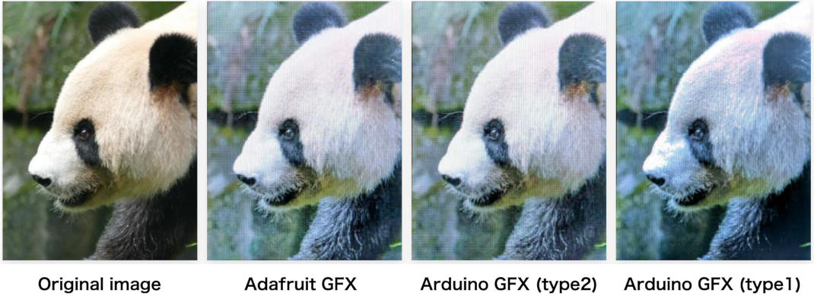
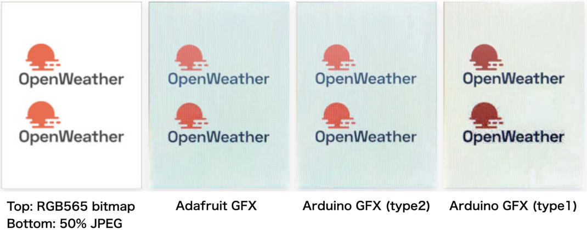
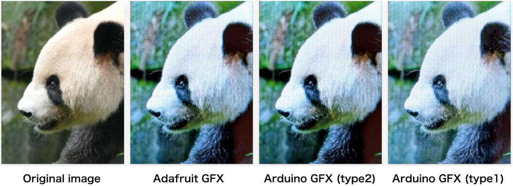
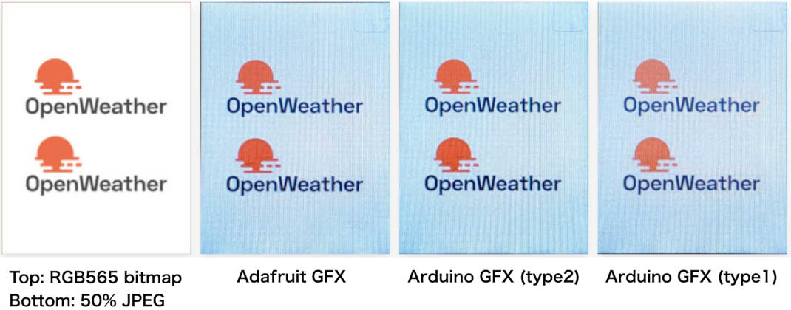

# Arduino_GFX Constructors and Color Reproducibility

This registry is used to verify color reproducibility in relation to the 
[Arduino_GFX constructor][1].

Assuming that color Reproducibility remains consistent across different 
graphics libraries when using the same LCD device, this comparison 
focuses on [Arduino GFX][2] and [Adafruit GFX][3].

## Requirements

### Graphic Libraries
- [Arduino_GFX][2]
- [Adafruit-GFX-Library][3]
  - [Adafruit_ILI9341][4]
  - [Adafruit-ST7735-Library][5]

### Target MCU boards
- [ArduinoCore-renesas][6] 1.6.0 or later
- [arduino-esp32][7] 3.3.12 or later

## Tested LCD
Tests were conducted on the following LCD devices, which utilize the 
ILI9341 and ST7789.

### SPI type
- [2.4inch SPI Module ILI9341 SKU:MSP2402 - LCD wiki][10]
- [2.8inch SPI Module ILI9341 SKU:MSP2807 - LCD wiki][11]

### 8 bit parallel (MCUFRIEND) type
- [2.4inch Arduino Display - LCD wiki][12]

## Results

### ILI9341

#### Panda
With the default "type1" setting, noticeable color misregistration 
occurred on the top of the panda's head and on the top of its nose.

#### Logo
With the default "type1" setting, the orange color takes on a dark, 
muddy hue, and the block noise characteristic of JPEG images becomes 
more noticeable.

### ST7789

#### Panda
With the default "type1" setting, the colors appear slightly fainter.
The difference is very subtle—likely only noticeable when compared 
directly against Adafruit GFX.

#### Logo
As with the panda image, the colors appear less vivid. Block noise 
in the JPEG image is also not very noticeable.

## Reference discussion
[Arduino GFX vs. Adafruit GFX — Differences in Color Reproduction #820][20]

[1]: https://github.com/moononournation/Arduino_GFX/blob/master/src/display/Arduino_ILI9341.h#L175-L179 "Arduino_GFX/src/display/Arduino_ILI9341.h at master · moononournation/Arduino_GFX"
[2]: https://github.com/moononournation/Arduino_GFX "moononournation/Arduino_GFX: Arduino GFX developing for various color displays and various data bus interfaces"
[3]: https://github.com/adafruit/Adafruit-GFX-Library "adafruit/Adafruit-GFX-Library: Adafruit GFX graphics core Arduino library, this is the &#x27;core&#x27; class that all our other graphics libraries derive from"
[4]: https://github.com/adafruit/Adafruit_ILI9341 "adafruit/Adafruit_ILI9341: Library for Adafruit ILI9341 displays"
[5]: https://github.com/adafruit/Adafruit-ST7735-Library "adafruit/Adafruit-ST7735-Library: This is a library for the Adafruit 1.8&quot; SPI display http://www.adafruit.com/products/358 and http://www.adafruit.com/products/618"

[6]: https://github.com/arduino/ArduinoCore-renesas "arduino/ArduinoCore-renesas"
[7]: https://github.com/espressif/arduino-esp32 "espressif/arduino-esp32: Arduino core for the ESP32 family of SoCs"

[10]: https://www.lcdwiki.com/2.4inch_SPI_Module_ILI9341_SKU:MSP2402 "2.4inch SPI Module ILI9341 SKU:MSP2402 - LCD wiki"
[11]: https://www.lcdwiki.com/2.8inch_SPI_Module_ILI9341_SKU:MSP2807 "2.8inch SPI Module ILI9341 SKU:MSP2807 - LCD wiki"
[12]: https://www.lcdwiki.com/2.4inch_Arduino_Display "2.4inch Arduino Display - LCD wiki"

[20]: https://github.com/moononournation/Arduino_GFX/discussions/820 "Arduino GFX vs. Adafruit GFX — Differences in Color Reproduction · moononournation/Arduino_GFX · Discussion #820"
